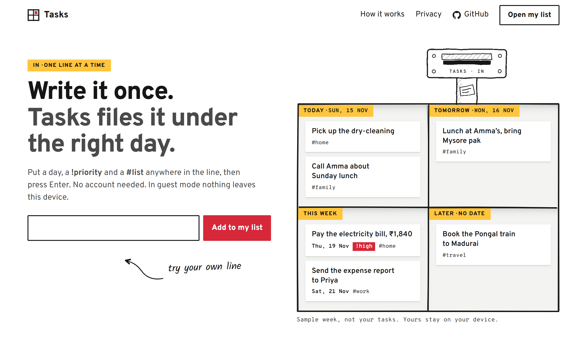
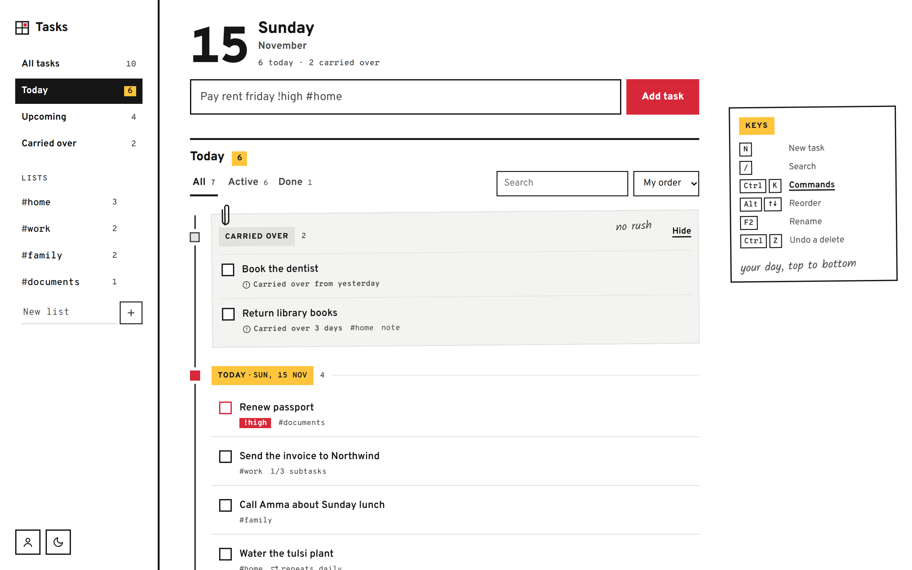
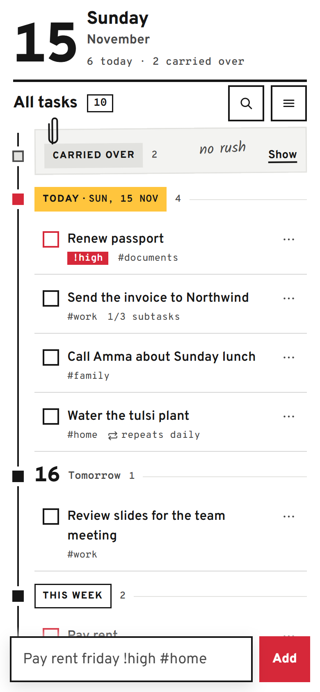

<p align="center">
  
</p>

<h1 align="center">Tasks</h1>

<p align="center">
  <b>Write it once. Tasks files it under the right day.</b><br>
  A free to-do list that you can run from the keyboard.<br>
  You do not need an account. In guest mode, your tasks stay on your device.
</p>

<p align="center">
  <a href="https://dheekshith-r.github.io/tasks/app/"><b>Open the app</b></a>
  &nbsp;·&nbsp;
  <a href="https://dheekshith-r.github.io/tasks/">Start page</a>
  &nbsp;·&nbsp;
  <a href="https://github.com/dheekshith-r/tasks/issues/new/choose">Report a problem</a>
</p>

<p align="center">
  <a href="https://github.com/dheekshith-r/tasks/actions/workflows/deploy.yml"></a>
  <a href="./LICENSE"></a>
  
</p>

<picture>
  <source media="(prefers-color-scheme: dark)" srcset="docs/images/start-dark.png">
  
</picture>

## One line does the work

Type a line and press Enter. Tasks reads three kinds of words anywhere in the line and files the task under its day.

```text
Pay rent friday !high #home
```

| Word in the line | What Tasks does with it |
|---|---|
| `today`, `tomorrow`, `friday`, `fri` | Sets the due date. A day name means the next one, and today counts. |
| `!high`, `!med`, `!low` | Sets the priority. Only `!high` gets a red tag. |
| `#home` | Puts the task in that list. A new name makes a new list. |

The field marks each word as you type, so you see what Tasks understood before you save.

## The app

<picture>
  <source media="(prefers-color-scheme: dark)" srcset="docs/images/app-dark.png">
  
</picture>

<table>
  <tr>
    <td width="38%">
      <picture>
        <source media="(prefers-color-scheme: dark)" srcset="docs/images/phone-dark.png">
        
      </picture>
    </td>
    <td>
      <b>On a phone</b>, the input sits at the bottom, near your thumb. Views and lists move into a menu.
      <br><br>
      <b>Carried over</b> tasks from earlier days wait in a grey slip that says "no rush". They do not turn red.
      <br><br>
      <b>Upcoming</b> groups tasks by day, with the day's number in large type.
    </td>
  </tr>
</table>

## Features

- **Views:** Today, Upcoming, Carried over, All tasks, and one view for each of your lists.
- **Task details:** quick dates (Today, Tomorrow, In a week), priority, list, notes and subtasks.
- **Repeating tasks:** every day, week or month. When you complete one, Tasks makes the next one.
- **Search:** press `/`. It looks in titles, notes and list names. Filter by All, Active or Done, and sort by your own order, due date or priority.
- **Reorder:** drag a task, or press `Alt` + `↑` / `↓`.
- **Undo:** a deleted task comes back with `Ctrl` + `Z` (`⌘` + `Z` on a Mac).
- **Command menu:** `Ctrl` + `K` (`⌘` + `K`) opens any view, list or task.
- **Light and dark** themes.
- **Backups:** export everything to a JSON file that you keep. On import, Tasks checks every field before it replaces anything.
- **Offline:** it works with no connection, and you can install it like an app.
- **Accessible:** a screen reader hears every change in plain words. Every control has a label, dialogs keep focus inside, and focus is always visible. Reduced motion is respected. CI checks colour contrast against WCAG AA.

### Keyboard

| Key | Action |
|---|---|
| `N` | New task |
| `/` | Search |
| `Ctrl` `K` / `⌘` `K` | Command menu |
| `Alt` `↑` `↓` | Move the task up or down |
| `F2` | Rename the task |
| `Ctrl` `Z` / `⌘` `Z` | Undo a delete |

## Privacy

- **Guest mode is the default.** You do not need an account. Your tasks stay in this browser and nothing is uploaded. The page makes no third-party requests, and the fonts come from this site.
- **Sign-in with Google is optional.** Use it to see the same list on your phone and your laptop. Your tasks are stored in Cloud Firestore at `users/<your id>/`, and the [security rules](./react/firestore.rules) let only you read or write them.
- **You can delete everything.** One button in the app deletes your cloud data and your account.
- **No ads and no analytics.**

## Free

Every feature is free. There is no paid plan, and the code is [MIT licensed](./LICENSE).

## Built with

| Part | Choice |
|---|---|
| UI | React 19.3, TypeScript 7 (strict) |
| Build | Vite 8: two pages, the start page and the app |
| Tests | Vitest 5 with jsdom and Testing Library, plus the Firestore emulator |
| Optional sync | Firebase 13 (Google sign-in and Cloud Firestore, free Spark plan) |
| Hosting | GitHub Pages, deployed by GitHub Actions |
| Fonts | Overpass, Overpass Mono and Kalam, served from this site |

## Quality checks

Every push and pull request runs these checks. Only a push to `main` deploys.

| Check | What it proves |
|---|---|
| `npm audit --audit-level=high` | No known high or critical vulnerabilities in dependencies |
| `npm test` | 221 unit, component and app tests pass |
| `npm run test:rules` | 17 tests prove that the Firestore rules let only the owner read or write |
| `npm run contrast` | Every text and background pair passes WCAG AA, in light and dark |
| `npm run build` | The type-check passes and both pages build |
| `npm run csp` | The built pages have a strict Content Security Policy |

## Run it on your computer

You need Node 22.12 or newer. CI uses Node 26 LTS.

```bash
cd react
npm install
npm run dev
```

Other commands:

```bash
npm test            # unit, component and app tests
npm run test:rules  # Firestore rules on the emulator (needs Java 21+)
npm run contrast    # WCAG AA check of the colour tokens
npm run build       # type-check and production build
npm run csp         # checks the built pages' Content Security Policy
```

Without Firebase variables, the build is guest-only. To turn on sign-in, follow [docs/FIREBASE_SETUP.md](./docs/FIREBASE_SETUP.md).

## Project structure

```text
react/
├── index.html            # the start page
├── app/index.html        # the app
├── firestore.rules       # who can read and write cloud data
├── scripts/              # contrast and CSP checks
└── src/
    ├── App.tsx           # views, groups, search, wiring
    ├── reducer.ts        # pure state logic
    ├── dates.ts          # local dates, due labels, repeats
    ├── storage.ts        # localStorage, and checks for stored and imported data
    ├── cloud.ts          # optional Firebase sign-in and sync
    ├── components/       # Sidebar, TaskForm, TaskItem, Drawer, Palette, AccountMenu, ...
    └── landing/          # the start page: the one-line parser, scenes, changelog
vanilla/                  # the first version, with no framework (it is still tested)
docs/                     # setup, research, design studies and images
```

## How it was made

The product followed one written path, from research to measurement:

| Document | What it holds |
|---|---|
| [RESEARCH.md](./RESEARCH.md) | The market, what users praise and what they complain about, with sources |
| [DEFINE.md](./DEFINE.md) | The customer, the pain, the outcome and what makes this version different |
| [DESIGN.md](./DESIGN.md) | The "Sorting Frame" design system: colours, type and rules |
| [SPEC.md](./SPEC.md) | Scope, screens, data and acceptance tests |
| [MEASURE.md](./MEASURE.md) | How we will measure the first moment that matters |
| [AI_WORKFLOW.md](./AI_WORKFLOW.md) | How AI helped, and how its work was checked |

## Deploy and roll back

A push to `main` runs every check and then deploys to GitHub Pages. To roll back a bad release:

1. Find the bad commit with `git log --oneline`.
2. Revert it with `git revert <commit>`.
3. Push to `main`. CI tests the revert and deploys the previous version.

To deploy a known good commit again, open the Actions tab and select "Run workflow".

## Contributing

Bug reports and ideas are welcome. Read [CONTRIBUTING.md](./CONTRIBUTING.md) first. To report a security problem, follow [SECURITY.md](./SECURITY.md) and do not open a public issue.

## License

[MIT](./LICENSE). Free, with no paid plan.
