# Pivot Tasks from "free" to "proven accessible"

> Product flow steps 1 and 2 (research the market, find winning ideas). Researched 2026-11-12 in one time-boxed session. The source notes, with every link and date, are in `docs/research/notes/`.

**Verdict: PIVOT the positioning and keep the product.** Two parts of Tasks' planned difference are already common. "No account" and "every paid feature free" are both offered by Super Productivity, an MIT, no-account web app with 23.6k GitHub stars that shipped v20 on 2026-11-06. Microsoft To Do and Google Tasks also give their features away, and they have the largest rating counts in the market. A third part, local-only storage with no sync, works against users. They praise cross-platform sync more than any other trait, and many leave Things 3 for the single reason that it does not reach all their devices. The part that is real and empty is **proven accessibility plus a true keyboard-first model on the web**. No leader publishes a WCAG 2.2 AA report. Google's own Tasks web report says keyboard use is only "Partially Supports". Todoist publishes no accessibility statement at all. A second empty space is a calm way to handle the backlog, because backlog guilt is the best-evidenced reason people quit to-do apps. Tasks should lead with "accessible, keyboard-first, calm, and yours", treat "no paywall" as a promise and not a headline, and add user-owned sync (file, then WebDAV or an encrypted relay) before it asks phone-and-laptop users to trust it. The biggest technical risk is Safari. It can delete all of a site's storage after 7 days of Safari use with no interaction on that site, so a to-do list kept only in a browser tab is one week away from total loss.

## Free bundled apps reach the most people, and Todoist leads the paid ones

The market has three layers, and each one makes money in a different way. The first layer is free apps from platform owners. Microsoft To Do has **270K US App Store ratings at 4.7 stars**, the highest count in the set ([App Store](https://apps.apple.com/us/app/microsoft-to-do/id1212616790)). Google Tasks has **108K ratings at 4.8** ([App Store](https://apps.apple.com/us/app/google-tasks-get-things-done/id1353634006)). Apple Reminders comes free on every Apple device. Zapier says that for most Apple users it "ticks a lot of boxes" ([Zapier](https://zapier.com/blog/best-todo-list-apps/)). These apps are paid for by the ecosystems around them, not by their users. Microsoft To Do keeps tasks in Exchange so they show up in Outlook ([Microsoft Support](https://support.microsoft.com/office/490c1a8c-2333-4952-8125-841afadb9620)), and Google put its 2026 AI task work into Gemini Spark, not into Tasks ([9to5Google](https://9to5google.com/2026/10/12/gemini-spark-task-redesign/)).

The second layer is independent freemium apps. **Todoist** charges $5/month billed yearly ($60/year) or $7 monthly for Pro, and $8 to $10 per user per month for Business. It claims "50 million+" users ([Todoist pricing](https://www.todoist.com/pricing)) and has **131K ratings at 4.8** ([App Store](https://apps.apple.com/us/app/todoist-to-do-list-planner/id572688855)). **TickTick** charges $49.99/year and has 47K ratings at 4.9, the highest star rating in the set ([App Store](https://apps.apple.com/us/app/ticktick-to-do-list-calendar/id626144601); [TickTick upgrade page](https://ticktick.com/about/upgrade)). **Any.do** charges $4.99 to $7.99 a month and sells through heavy discounts ([Any.do pricing](https://www.any.do/pricing)). **Things 3** is the exception: a one-time price per device ($9.99 iPhone, $19.99 iPad, $49.99 Mac), two Apple Design Awards, and free sync. It runs on Apple platforms only ([App Store](https://apps.apple.com/us/app/things-3/id904237743); [Cultured Code](https://culturedcode.com/things/mac/store/)).

The third layer is professional planners that charge $16 a month or more. Sunsama is $16/month with no free tier ([Akiflow blog](https://akiflow.com/blog/amie-vs-sunsama)). Motion has an estimated **$50M ARR** for AI auto-scheduling, which is an analyst estimate and not audited ([Sacra](https://sacra.com/c/motion)). The answer to "who buys" follows from these layers. Most people do not pay; they use whatever comes with their phone or office suite. People who pay $50 to $60 a year are power users who need cross-platform reach and planning views. The money at the top of the market comes from professionals who buy time-blocking, not lists.

User sentiment explains how people move between layers. Price is the strongest trigger to switch. Todoist raised Pro on 10 December 2025 from $5 to $7 monthly (+40%) and from $48 to $60 yearly (+25%), its first rise since 2022. In an Android Authority reader poll, **71% of 184 voters said they would move to another app**. The poll was self-selected, so it measures anger, not actual churn ([Android Authority](https://www.androidauthority.com/best-todoist-alternatives-3615857/)). A review-analysis vendor puts "pricing and subscription changes" at 18% of 1-3 star reviews across seven apps. It ranks "performance and speed" first at 21%, mostly Notion, and "sync issues and data loss" third at 15%. The vendor gives no sample size, so treat these shares as direction only ([Unstar.app](https://unstar.app/blog/productivity-app-reviews-what-power-users-complain-about-2026)). The pattern is that users do not mainly resent a high price. They resent a change in the deal. Long-time users "feel betrayed" when a feature they downloaded the app for, such as natural-language input, moves behind Premium ([Unstar.app ranking](https://unstar.app/blog/todoist-ticktick-things-3-microsoft-todo-apple-reminders-todo-apps-ranked-2026)). Sync failures hurt even the giants. Microsoft's own forums show one-way sync on shared lists, stalled syncs and list orders that do not sync from August 2025 onward ([Microsoft Tech Community](https://techcommunity.microsoft.com/discussions/to-do/synchronization-issue/4445162)).

Praise points the other way. Across a Reddit mention ranking of 450 reviews, Todoist (63 mentions) and TickTick (41) lead. Their stated strengths are cross-platform sync, a useful free tier and easy capture ([GummySearch](https://gummysearch.com/tools/best-products/to-do-list-app)). Things 3's Quick Entry is the most-praised single feature: it opens in under a second from any app ([Capterra](https://www.capterra.com/p/119096/Things/reviews/)).

Abandonment has a different cause from switching. People switch over price, but they quit over upkeep and guilt. The largest 2025 signal is the Hacker News thread "I tried every todo app and ended up with a .txt file", with **1,402 points and 799 comments**. Its themes are tools that are too opinionated, tinkering as a way to procrastinate, and backlog guilt. One commenter called solving the backlog "the holy grail of To-Do systems" ([HN 44864134](https://news.ycombinator.com/item?id=44864134)). Academic work agrees but is old. Haraty and colleagues found that all personal task solutions have high abandonment rates and that people choose pen and paper again and again. They give no percentage ([IJHCS 2016](https://www.cs.ubc.ca/labs/edapt/papers/haraty2016_2.pdf)). Todoist's CEO once said about 70% of active users have at least one overdue task, and that a long overdue list "creates a lot of anxiety". That figure is from 2016 ([Fast Company](https://www.fastcompany.com/3065714/todoists-ai-task-scheduler-could-help-you-procrastinate-less)). No reliable 2024-2026 survey gives an abandonment percentage, and this report does not invent one.

## Eight winning ideas recur, and only two of them need money

The leaders repeat a small set of ideas. The table lists each idea and its evidence. The last column shows whether a free, browser-only, open-source app can match it.

| Winning idea | Evidence | Can Tasks match it in a browser? |
|---|---|---|
| Natural-language quick add (date, recurrence, project, label, priority in one line) | Todoist's grammar covers `#project`, `@label`, `p1-p4` and "every!" (repeat from completion) ([Todoist help](https://todoist.com/help/articles/115001745265)); users rate it best in class ([dev.to review](https://dev.to/onsen/todoist-review-2026-honest-opinion-after-daily-use-moe)) | Yes, fully, with rule-based parsing |
| Same list on every device | Cross-platform reach is the top praise for Todoist and TickTick and the top reason people leave Things ([get-alfred.ai](https://get-alfred.ai/blog/best-things-3-alternatives); [GummySearch](https://gummysearch.com/tools/best-products/to-do-list-app)) | Only with sync, which local-only storage does not have |
| Ecosystem integration | MS To Do and Google Tasks win through Outlook and Google apps and hold the top rating counts ([Zapier](https://zapier.com/blog/best-todo-list-apps/)) | No; this is a platform-owner advantage |
| Calendar, duration and daily planning views | TickTick is "best for embedded calendars and timers"; Todoist moved calendar and duration into Pro ([Zapier](https://zapier.com/blog/best-todo-list-apps/); [Todoist pricing](https://www.todoist.com/pricing)) | Yes, all local UI |
| Focus and habit tools | TickTick's Pomodoro and habits are praised and it syncs focus time to Apple Health ([App Store](https://apps.apple.com/us/app/ticktick-to-do-list-calendar/id626144601)) | Timers and habits yes; HealthKit no |
| AI capture and agent access | Todoist Ramble: 76,000 users ran about 290,000 voice sessions in three weeks of beta ([TechCrunch](https://techcrunch.com/2026/01/21/todoists-app-now-lets-you-add-tasks-to-your-to-do-list-by-speaking-to-its-ai/)); Superlist shipped an MCP server so AI assistants can edit tasks ([Product Hunt](https://www.producthunt.com/products/superlist/launches/superlist-2)) | Partly; LLM quality needs a server |
| Generous free tier with a clear upgrade line | Todoist free: 5 projects, 3 filters; TickTick "always free" with Premium limits ([Todoist pricing](https://www.todoist.com/pricing); [TickTick](https://ticktick.com/about/upgrade)) | Yes, and Tasks can drop the upgrade line |
| Design craft with a one-time price | Things 3: two Apple Design Awards, 4.8 stars ([App Store](https://apps.apple.com/us/app/things-3/id904237743)) | Yes, as craft; price is zero |

Two points stand out. First, **capture speed is the one idea that every source type praises**: store reviews, Reddit rankings, HN and editors all praise it. It is also the cheapest to build well. Second, AI in 2026 creates value in capture (voice, email, suggestions) and works as a paywall lever. Todoist limits free users to **10 AI capture sessions a month** and ignores a dictated deadline or duration on the free plan ([Todoist usage limits](https://www.todoist.com/help/todoist/get-started/usage-limits-in-todoist-e5rcSY)). The research found no direct evidence that users reject AI in to-do apps, so "no AI" is not a selling point to rely on.

Accessibility is a ninth idea that no leader has claimed. Google's Tasks web conformance report (17 December 2024) marks 2.1.1 Keyboard as "Partially Supports", because multiple functions on the landing page and the My Tasks pop-up cannot be done by keyboard alone. It also says checkbox state is not exposed to assistive technology in the date widget, and that colour is the only signal for selected state in five areas ([Google Tasks ACR](https://services.google.com/fh/files/misc/google_tasks_vpat.pdf)). Microsoft publishes screen-reader guides for To Do on five platforms ([Microsoft Support](https://support.microsoft.com/en-us/accessibility/todo/screen-reader-support-for-microsoft-to-do)). Todoist, TickTick, Things and Any.do publish no statement or VPAT that the research could find. A blind Todoist user said the iPhone app is fully accessible but desktop and web "have some work to go"; that comment is from 2021 ([AppleVis](https://www.applevis.com/forum/ios-ipados/todoist-voiceover)). The wider web sets a low bar: **95.9% of the top million home pages fail WCAG 2 checks**, and empty buttons appear on 30.6% of them ([WebAIM Million 2026](https://webaim.org/projects/million/)). Trust is fragile. In December 2025 blind users went looking for a "100% blind accessible" app after Finch became inaccessible "despite many requests and complaints" ([r/Blind](https://www.reddit.com/r/Blind/comments/1peccu6/suggestions_for_a_100_blind_accessible_todohabits/)).

## Free and no-account are taken; proof of access and calm are open

Each of Tasks' five intended differences faces a different level of competition, so each one needs its own test.

**"Every paid feature, free" is not unique and not a moat.** Super Productivity is MIT, free, has no account, runs on the web and five native platforms, and offers optional sync through its own end-to-end encrypted SuperSync, Dropbox or WebDAV ([GitHub](https://github.com/super-productivity/super-productivity)). Microsoft To Do and Google Tasks have no in-app paywall. Things 3 has nothing paywalled after purchase. A user who leaves Todoist over price already has several free places to go. The promise still matters in one way: it removes the "change in the deal" fear that drives the anger described above. An MIT licence makes that promise credible, because users can fork the app if it ever breaks the deal. So Tasks should keep "no paywall, ever" as a guarantee in the footer and the README. The headline should be something else. "Everything free" also invites bloat. A long-time Todoist user left TickTick because it had "too many features that were just distracting side quests" ([Doolpa](https://doolpa.com/article/ticktick)), and bloat works against the calm position.

**"No account" is valued by a vocal minority, and almost none of them want "no sync".** On HN, users reject apps that need a login or are "not local first, proprietary, subscriptions, or no encryption". The same users sync with Syncthing, CalDAV or Nextcloud ([HN 44864134](https://news.ycombinator.com/item?id=44864134)). The maker of a no-account todo.txt app reports that users ask for cross-device sync ([Product Hunt](https://www.producthunt.com/posts/tasks-txt)). In this research's GitHub searches (12 November 2026), the pure localStorage-only, keyboard-first web niche had **no breakout project above roughly 300 stars**. The one larger local-only web planner, WeekToDo (2.2k stars), has had no release since February 2024 ([WeekToDo](https://github.com/manuelernestog/weektodo)). That fits weak demand for no-sync apps better than it fits an open gap. The pattern that wins in these communities is "no vendor account, plus sync the user controls".

**Open source is table stakes in this segment, not a difference.** The field is crowded and active. Mindwtr went from a new repo to **2,390 stars in about 11 months**, tuxedo reached 1,900 in about 6 months, and OpenTodo reached 390 in about one month ([Mindwtr](https://github.com/dongdongbh/Mindwtr); [tuxedo](https://github.com/webstonehq/tuxedo); [OpenTodo](https://github.com/OpenTodoApp/OpenTodo)). Focused new tools can still gain traction. They also show that rivals appear every month.

**Keyboard-first is a quality bar, not a headline.** Todoist already ships single-key shortcuts, G-then-X navigation and a Ctrl/Cmd+K Quick Find ([Todoist shortcuts](https://www.todoist.com/help/articles/use-keyboard-shortcuts-in-todoist-Wyovn2)). Still, users can feel a difference between "has shortcuts" and "built for the keyboard". Godspeed, a "100% keyboard oriented" Mac app, drew 328 points on HN, and a Vim user said Todoist felt "built first for mouse-use" ([HN 39756325](https://news.ycombinator.com/item?id=39756325)). Todoist has one concrete gap. Its shortcuts support only QWERTY and QWERTZ, and its indent shortcuts need `[` `]` keys that "many non-English layouts" lack ([Todoist shortcuts](https://www.todoist.com/help/articles/use-keyboard-shortcuts-in-todoist-Wyovn2)). Layout-independent shortcuts are a small, provable advantage.

**Proven accessibility is the strongest real difference.** One full keyboard model (roving focus, no hover-only actions, predictable shortcuts) serves keyboard power users and screen-reader users together. Lack of keyboard access is the fifth worst barrier for screen-reader users ([WebAIM SR Survey #10](https://webaim.org/projects/screenreadersurvey10/)). A public WCAG 2.2 AA conformance report, plus an accessibility regression suite in CI, would put Tasks ahead of every leader on paper. It also answers the "one update broke it" fear. The audience is large in total: about 16% of the world's people have a significant disability ([WHO](https://www.who.int/news-room/fact-sheets/detail/disability-and-health)), and 15.5 million US adults (6.0%) report an ADHD diagnosis ([CDC MMWR](https://www.cdc.gov/mmwr/volumes/73/wr/mm7340a1.htm)). The share of to-do users in these groups is unknown. There is one honest limit: 58% of screen-reader users prefer an app to a website for common tasks ([WebAIM SR Survey #10](https://webaim.org/projects/screenreadersurvey10/)). A web app must be clearly better on desktop, where JAWS and NVDA dominate, to win them.

**Calm backlog handling is the second open difference, and the cheapest.** ADHD users describe a "fear-freeze-shame cycle" once tasks go overdue ([r/adhdwomen](https://www.redditmedia.com/r/adhdwomen/comments/14w20cf/unable_to_complete_tasks_once_theyre_overdue_and/)). Zapier's ADHD picks reward apps where unfinished tasks roll over without penalty, such as Twos ([Zapier](https://zapier.com/blog/adhd-to-do-list/)). Most other ADHD evidence comes from vendor blogs, so confidence is low. Tasks can still build the obvious features cheaply: a "today only" default view, gentle roll-forward in place of red overdue counts, and a fade or archive for stale tasks. These features target the main cause of abandonment directly.

**Against Super Productivity specifically,** Tasks cannot win on privacy, price, licence or sync options, because SP already has all four. Tasks can win on three things. The first is simplicity: the HN thread says to-do software is "too opinionated". The second is proven accessibility; SP's accessibility status was not checked in this research. The third is smoother sync setup. SP users report that Dropbox sync must be set up again on each new PC or browser, and one user stayed local-only because the mobile app is strict about SSL certificates ([r/superProductivity mirror](https://reddit.birdcat.cafe/r/superProductivity); [Lemmy](https://campfyre.nickwebster.dev/post/2157732)). One weak signal favours a focused newcomer: SP's HN posts drew only 28 and 5 points despite its large star count ([HN 2023](https://news.ycombinator.com/item?id=38664792); [HN 2026](https://news.ycombinator.com/item?id=46481400)). The SP brand has not won the attention of the HN crowd that shapes this niche.

### Kill-gate verdict: PIVOT (positioning), with go and stop gates

| Gate | Result | Reason |
|---|---|---|
| Is the stated difference unique? | **Fail** for "free + no account + open source"; **pass** for "proven accessible + keyboard-first + calm" | SP, MS To Do and Google Tasks already cover free and no-account. No leader publishes a WCAG AA report, and Google's report fails parts of keyboard access. |
| Does it meet the core user need? | **Fail** as local-only | Same list on phone and laptop is the top praise and the top exit reason. Local-only storage cannot do this. |
| Is demand shown? | **Weak pass** | Local-first and no-account apps gain stars fast (Mindwtr, tuxedo). The localStorage-only niche shows no breakout. Mass-market demand is unproven ([HN 45333021](https://news.ycombinator.com/item?id=45333021)). |
| Is it defensible? | **Weak** | Open source can be copied. The defence is a process: a public conformance report, an a11y test suite and a calm design that rivals would have to rebuild. |

The verdict is **pivot, not stop**. Keep the product. Change the headline from "no account, everything free" to "the to-do web app anyone can use with a keyboard or a screen reader: calm, fast, yours, no paywall ever". Add user-owned sync. The gates below are proposals by this report, sized against the observed growth of rivals; no source sets them. **Go** if, within about six months, Tasks ships a published WCAG 2.2 AA report, sync through a file or WebDAV, and early traction near the OpenTodo pace (a few hundred stars in the first months). **Stop or fold the work into an upstream contribution** (for example, accessibility fixes to Super Productivity) if, after a sync option exists, traction stays flat and screen-reader testers do not prefer it to Todoist or MS To Do on desktop.

## Most paywalled features run free in a browser; sync, sharing and delivery do not

No source makes this split. The table is this report's analysis of the paid features listed on the vendors' own pricing pages ([Todoist pricing](https://www.todoist.com/pricing); [Todoist usage limits](https://www.todoist.com/help/todoist/get-started/usage-limits-in-todoist-e5rcSY); [TickTick upgrade](https://ticktick.com/about/upgrade); [Any.do pricing](https://www.any.do/pricing)).

| Paid in a competitor | Who paywalls it (free limit) | Browser-only, free | Needs a server | Needs a native app |
|---|---|---|---|---|
| More projects, lists, tasks, subtasks | Todoist (5 projects), TickTick (9 lists, 99 tasks/list, 19 checklist items) | Yes | | |
| Custom filters / smart lists | Todoist (3), TickTick (none) | Yes | | |
| Calendar, table, timeline, full Eisenhower views | Todoist, TickTick | Yes | | |
| Task duration, deadlines | Todoist, TickTick | Yes | | |
| Repeating tasks | Any.do | Yes | | |
| Colour tags, themes | Any.do, Todoist (4 themes), TickTick | Yes | | |
| Full activity history | Todoist (1 week), TickTick (none) | Yes (local event log) | | |
| Auto backups | Todoist | Yes, to a local file | Off-site copy needs a server or the user's cloud drive | |
| More habits, countdowns, statistics, focus timer | TickTick (5 habits, "Basic" stats) | Yes | | |
| Larger or more attachments | Todoist (5 MB), TickTick (1/day) | Yes, stored on the device | To sync files between devices | |
| Multiple, nagging or relative reminders | Todoist, TickTick | Partly: only while the tab is open or the PWA runs | Reliable background push needs a push server | Most reliable on native |
| Voice capture into tasks | Todoist (10/month), TickTick | Partly: rule-based parsing on the device | LLM-quality parsing | |
| AI assistant, email-to-task, recording summary | Todoist, TickTick, Any.do | | Yes | |
| Email and WhatsApp reminders | TickTick, Any.do | | Yes | |
| Calendar subscriptions (iCal in) | TickTick | | Usually a proxy, because of CORS | |
| Integrations (OAuth, webhooks) | TickTick, Any.do | File import/export only | Yes | |
| Sharing, family space, team workspaces, roles | TickTick (2 members), Any.do Family/Teams, Todoist Business | | Yes | |
| Cross-device sync | Free in all six leaders | User-owned file only | Relay or WebDAV, or P2P | |
| Location reminders | Todoist, Any.do | | | Yes (background geofencing) |
| Home-screen widgets, HealthKit sync | TickTick | | | Yes |

The main finding is that **the features with the most visible paywalls are pure local logic**. These are calendar views, durations, deadlines, filters, capacity limits, history, backups and recurrence. Tasks can offer every one of them free at no running cost. The features that need a server are sync, sharing and AI, and they are the ones that cost a vendor money every month. That is why vendors charge for them, and why a free GitHub Pages app cannot easily give them away. A static host can still serve an end-to-end encrypted relay only if someone runs that relay. "Free forever" therefore holds for the local features and for bring-your-own-storage sync. It does not hold for a hosted relay unless Tasks finds a sponsor or users self-host.

## Safari, sync and demand are the risks, and the sources point to fixes

**Safari eviction is the most dangerous risk, because it causes silent total loss.** With tracking prevention on, Safari deletes all script-writable storage (localStorage, IndexedDB, service worker caches) for a site that gets no user interaction during 7 days of Safari use ([WebKit 2020](https://webkit.org/blog/10218/full-third-party-cookie-blocking-and-more/); [MDN](https://developer.mozilla.org/en-US/docs/Web/API/Storage_API/Storage_quotas_and_eviction_criteria)). Eviction removes all of an origin's data at once. Home Screen web apps keep their own day count, and WebKit "does not expect" their first-party data to be deleted ([WebKit 2020](https://webkit.org/blog/10218/full-third-party-cookie-blocking-and-more/)). Since iOS 26, every site added to the Home Screen opens as a web app by default, so the exemption is one tap away ([heise](https://heise.de/-10749652)). Since Safari 17, `navigator.storage.persist()` is fully supported. WebKit grants it by heuristics such as whether the site runs as a Home Screen app, and persistent origins can be excluded from eviction ([WebKit 2023](https://webkit.org/blog/14403/updates-to-storage-policy/)). Chromium grants persistence silently based on interaction history, and Firefox asks the user ([MDN](https://developer.mozilla.org/en-US/docs/Web/API/Storage_API/Storage_quotas_and_eviction_criteria)). The research found no 2025-2026 WebKit statement that confirms the 7-day rule still applies in Safari 26, so assume it does. The fixes, in order of value, are these:

1. Ask iOS users to add Tasks to the Home Screen.
2. Call `persist()` on first use and show the result.
3. Store data in IndexedDB rather than localStorage. The eviction rules are the same, but IndexedDB is asynchronous and larger.
4. Offer one-key export and a scheduled backup file.
5. Show a visible "last backup" date.

**Sync is the risk to adoption.** Local-first apps that work in practice sync in a few ways. The most common is through the user's own storage: Dropbox, iCloud, WebDAV, Nextcloud or a plain text file with Syncthing. Others use self-hosted servers, or an optional encrypted vendor relay such as SuperSync ([Super Productivity](https://github.com/super-productivity/super-productivity); [Mindwtr](https://github.com/dongdongbh/Mindwtr); [Tasks.org docs](https://tasks.org/docs/)). The largest HN debate on local-first adoption names the real costs: conflict resolution, multi-device complexity, and users who choose convenience. Commenters add that last-write-wins can silently lose data and that CRDTs guarantee convergence but do not remove conflicts ([HN 45333021](https://news.ycombinator.com/item?id=45333021)). The lowest-risk ladder for Tasks has three rungs:

1. A JSON or todo.txt export and import that works today.
2. A file the user saves to a folder they already sync.
3. An optional WebDAV target or end-to-end encrypted relay.

For a dataset this small, per-item timestamps with last-write-wins are often enough. A CRDT library such as Yjs (23k stars) or Automerge is the safer choice if two devices must never lose an edit ([Yjs](https://github.com/yjs/yjs); [Automerge](https://github.com/automerge/automerge)). Evolu is built for end-to-end encrypted, no-account sync on the web and is actively maintained ([Evolu](https://github.com/evoluhq/evolu)). Whatever Tasks picks, setup friction is the cost users report most. A one-time pairing code beats per-device tokens and certificate errors, the problems SP users describe.

```mermaid
flowchart LR
  A[Browser tab only<br/>7-day Safari risk] --> B[Home Screen app<br/>+ persist&#40;&#41;]
  B --> C[Export / scheduled<br/>backup file]
  C --> D[File in user-synced folder<br/>phone + laptop]
  D --> E[Optional WebDAV or<br/>E2EE relay]
```

**Demand is the strategic risk.** The evidence for no-account and local-first demand comes from developers and privacy-minded users. The signals are 40 "local-first" HN stories above 200 points ([HN Algolia](https://hn.algolia.com/api/v1/search?query=local-first&tags=story&numericFilters=points>200)) and a Local-First Conf that grew to about 400 attendees in 2026 with digital sovereignty as a major theme ([Adam Wiggins](https://adamwiggins.com/posts/politics-and-emotion-at-local-first-conf/)). These are the people who give GitHub stars. They say little about mainstream users. The accessibility position widens the audience beyond that crowd, but blind users mostly recommend simple, stable native apps such as Apple Reminders and AnyList ([AppleVis](https://www.applevis.com/forum/ios-ipados/what-easiest-learn-easiest-use-do-list-app-sharing-family-members)). Tasks must earn their trust over time. The fixes are visible proof and outreach to the communities where these users talk. Visible proof means a published conformance report, NVDA + Chrome and VoiceOver + Safari test notes, and an accessibility changelog. Outreach means HN Show posts aimed at keyboard users, plus AppleVis and r/Blind for testing.

## Conclusion

The research changes the question. It is no longer "can a free app beat paid apps on features?". Free already exists, and features are cheap to copy. The question now is "what can a free app prove that funded apps have not bothered to prove?". The answer is access and calm. Leaders compete on capture speed, sync and AI, and they spend their margins there. None of them has made a public, testable promise that a keyboard-only or screen-reader user can do everything. None has designed against the backlog guilt that causes people to quit. An MIT app has a structural reason to make both promises: it has no upsell to protect, and anyone can check the source.

The weak point is not competitors; it is the storage model. A local-only to-do app breaks two things users care about most: one list on two devices, and not losing data. Sync and backup are therefore not later features. They are the condition for the rest of the positioning to work. Build the backup and Home Screen safeguards first, user-owned sync second, and the accessibility proof alongside both. Then measure demand against the pace that Mindwtr and OpenTodo set before investing further.
